<div align="center">

# 🛡️ SFK Secure — Multi-Factor Authentication

**A production-style full-stack auth starter: email/password sign-in, TOTP two-factor authentication, QR-code enrollment, one-time backup codes and server-side session management.**

React 18 · Vite · Node.js · Express · Passport.js · Mongoose · MongoDB · speakeasy · qrcode

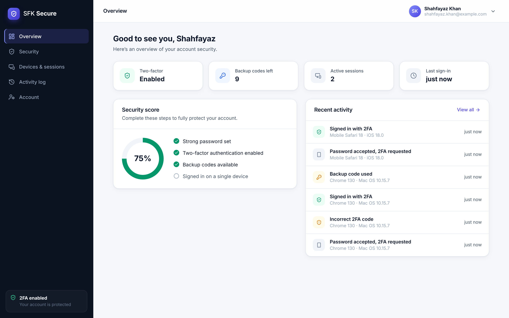

</div>

---

## Table of contents

- [Highlights](#highlights)
- [Screenshots](#screenshots)
  - [1. Sign in & create an account](#1-sign-in--create-an-account)
  - [2. Enroll in 2FA with a QR code](#2-enroll-in-2fa-with-a-qr-code)
  - [3. Signing in with 2FA](#3-signing-in-with-2fa)
  - [4. Dashboard](#4-dashboard)
  - [5. Security settings](#5-security-settings)
  - [6. Devices & sessions](#6-devices--sessions)
  - [7. Activity log](#7-activity-log)
  - [8. Account](#8-account)
  - [9. Built-in protections](#9-built-in-protections)
  - [10. Mobile](#10-mobile)
- [Architecture & diagrams](#architecture--diagrams)
- [Project structure](#project-structure)
- [Quick start](#quick-start)
- [Configuration](#configuration)
- [Features](#features)
- [API reference](#api-reference)
- [Testing](#testing)
- [Troubleshooting](#troubleshooting)
- [Production notes](#production-notes)

---

## Highlights

| | |
| --- | --- |
| 🔐 **Passport local strategy** | Email + password with bcrypt, account lockout and enumeration-safe errors |
| 📱 **TOTP 2FA (speakeasy)** | Works with Google Authenticator, Microsoft Authenticator, Authy, 1Password… |
| 🔳 **QR-code enrollment** | 4-step wizard — install app → scan QR → verify → save backup codes |
| 🗝️ **Backup codes** | 10 one-time recovery codes, hashed at rest, copy / download / print |
| 🍪 **Secure sessions** | `express-session` + MongoDB store, httpOnly cookies, rotation on login, idle + absolute timeouts |
| 💻 **Device management** | See every signed-in device and sign any of them out remotely |
| 🧾 **Audit log** | 90 days of security events with filters |
| 🛡️ **Hardening** | CSRF tokens, origin checks, rate limiting, replay protection, AES-256-GCM secret encryption |

---

## Screenshots

> All screenshots are taken from the running app. They live in [`screenshots/`](screenshots/).

### 1. Sign in & create an account

| Sign in | Create account |
| :---: | :---: |
| 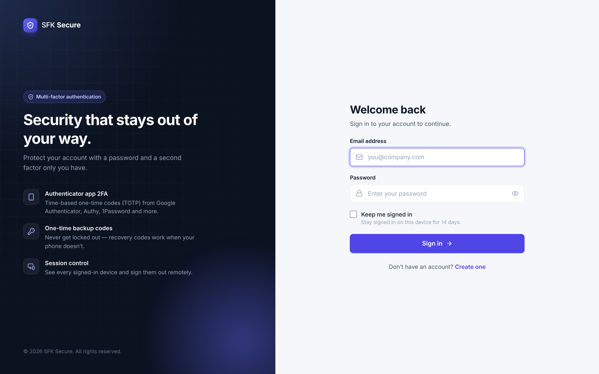 | 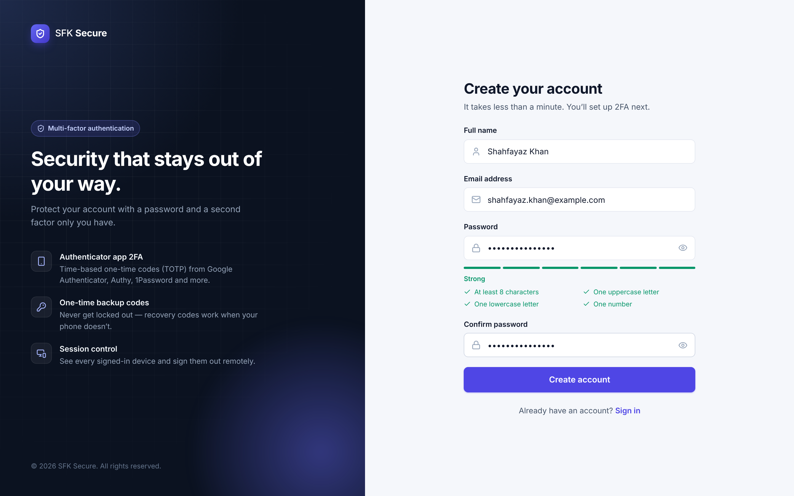 |

**Sign in** — The split layout pairs a branded panel with the form. Users sign in with email and password (validated by Passport's `LocalStrategy`). **Keep me signed in** extends the session from 60 minutes of inactivity to 14 days.

**Create account** — The live **password-strength meter** checks every rule as you type: 8+ characters, upper- and lower-case, and a number. The server enforces the same rules with zod. After sign-up the user is signed in straight away and taken to the 2FA setup wizard.

### 2. Enroll in 2FA with a QR code

| Step 1 — Get an app | Step 2 — Scan the QR code |
| :---: | :---: |
| 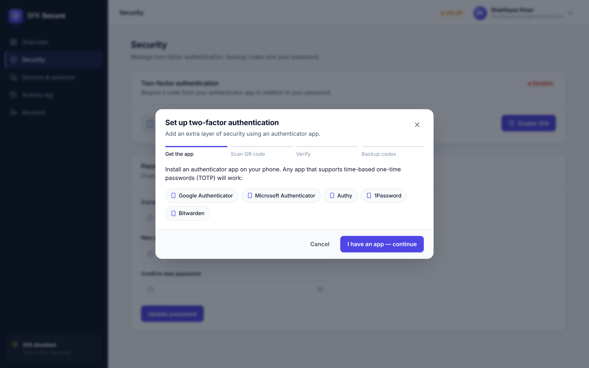 | 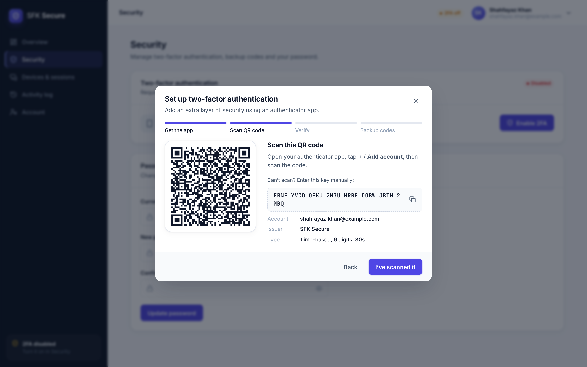 |
| **Step 3 — Verify a code** | **Step 4 — Save backup codes** |
| 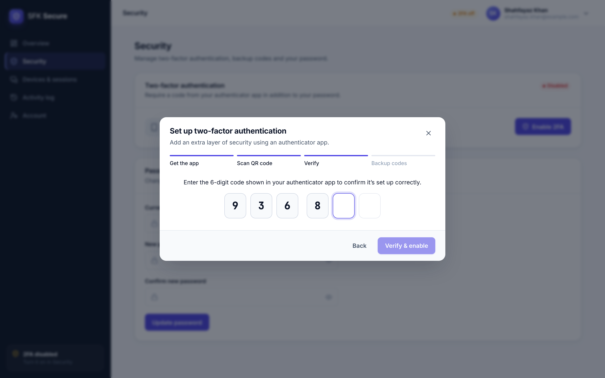 | 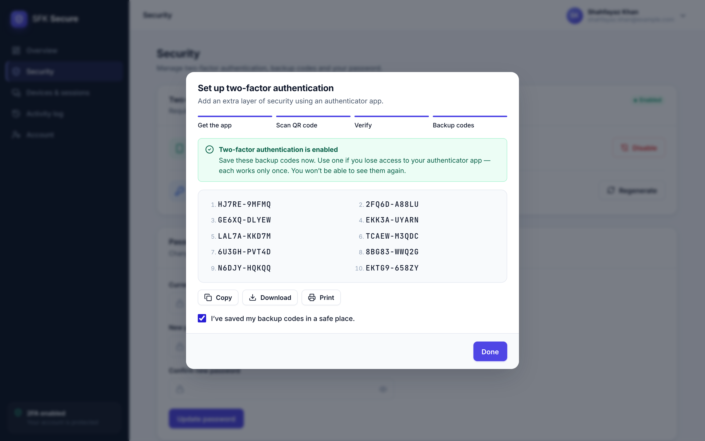 |

1. **Get an app** — lists compatible TOTP authenticator apps.
2. **Scan the QR code** — the server generates a secret with `speakeasy.generateSecret()` and builds an `otpauth://` URL. It returns the URL as a QR image made with `qrcode`. A **manual setup key** with a copy button is shown for people who can't scan. Until confirmed, the secret is stored only as an encrypted, 15-minute *temporary* secret.
3. **Verify** — the user enters the current 6-digit code. 2FA is enabled only if the code matches, which proves the app was set up correctly. The 6-box code input supports paste, arrow keys and phone autofill.
4. **Backup codes** — 10 one-time recovery codes are shown **once**, with Copy, Download (.txt) and Print buttons. **Done** stays disabled until the user confirms they've saved them. Enabling 2FA also signs out every other session that only passed a password check.

### 3. Signing in with 2FA

| 2FA challenge | Wrong code | Backup code |
| :---: | :---: | :---: |
| 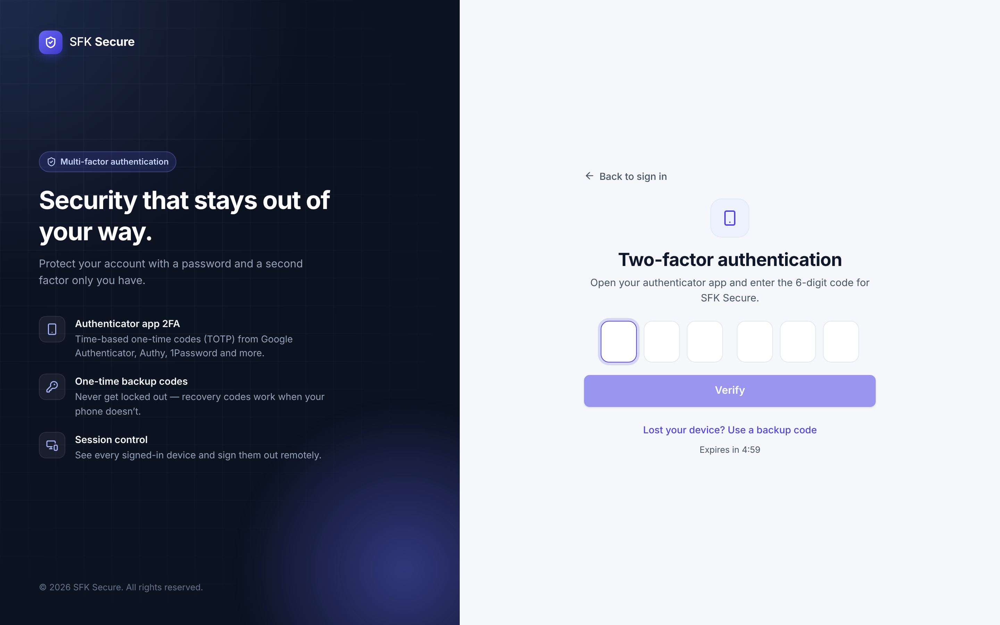 | 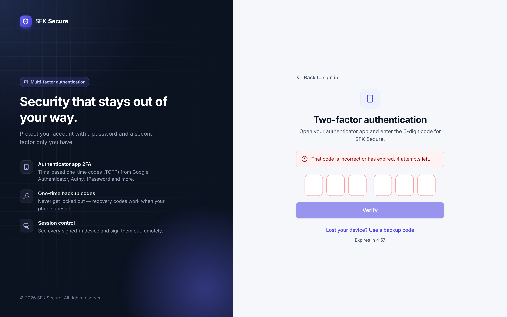 | 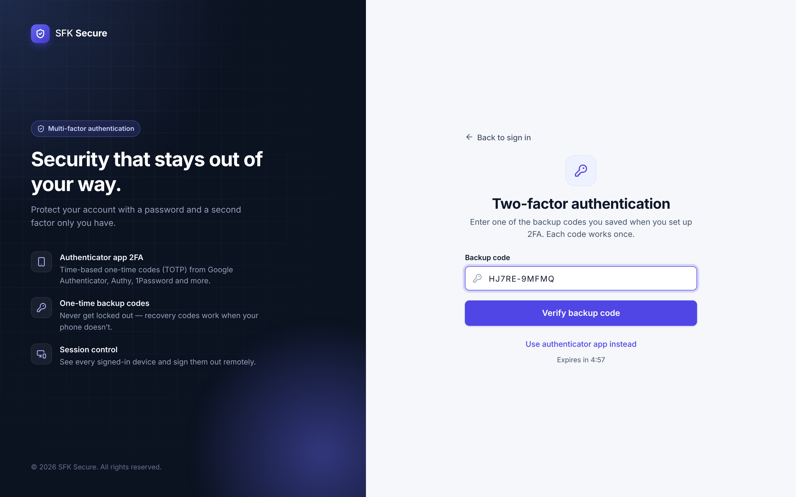 |

- **Challenge** — a correct password does **not** sign the user in yet. The server parks them in a short-lived *pending-MFA* state (5 minutes, with a countdown on screen) and protected routes stay locked.
- **Wrong code** — the error shows how many attempts are left. After 5 wrong codes the pending sign-in is discarded and the user starts over. Codes are checked within ±1 time step (to allow for clock drift), and a code that has already been used is rejected.
- **Backup code** — *Lost your device?* switches to recovery-code entry. Each backup code works exactly once, and the user is told how many remain.

### 4. Dashboard

| 2FA disabled | 2FA enabled |
| :---: | :---: |
| 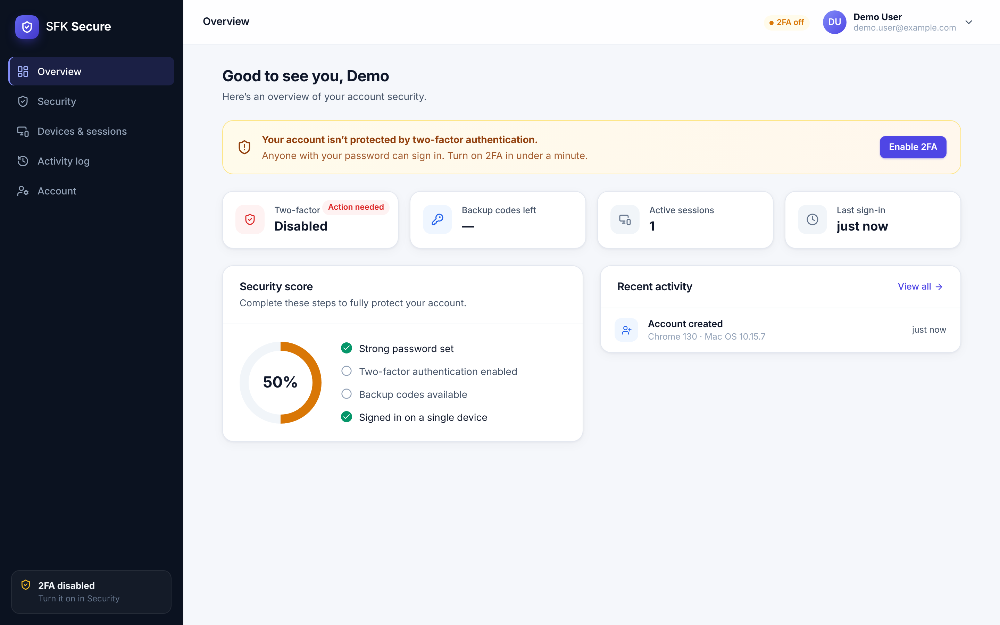 |  |

The overview shows:

- **Stat cards** — 2FA status, backup codes left, active sessions and last sign-in.
- **Security score** — a checklist of recommended steps.
- **Recent activity** — the latest security events with browser and OS.

When 2FA is off, a warning banner and an *Action needed* badge prompt the user to enable it.

### 5. Security settings

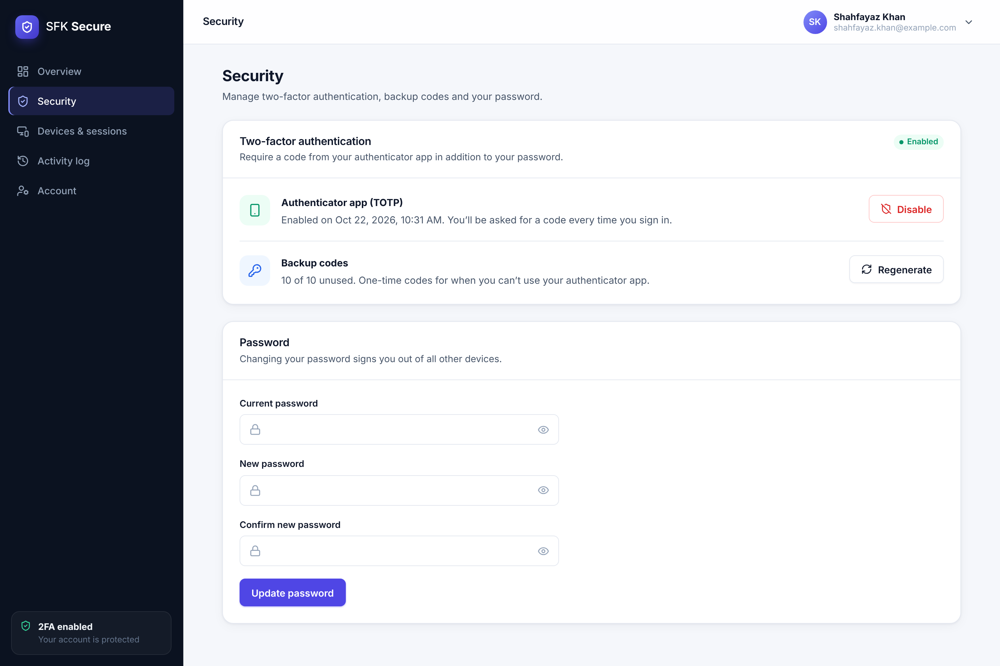

The central place to manage 2FA:

- Enable or **disable** the authenticator app.
- See how many **backup codes** are left, with a low-codes warning at 3 or fewer.
- **Change your password**, which signs out all other devices.

| Regenerate backup codes | Disable 2FA |
| :---: | :---: |
| 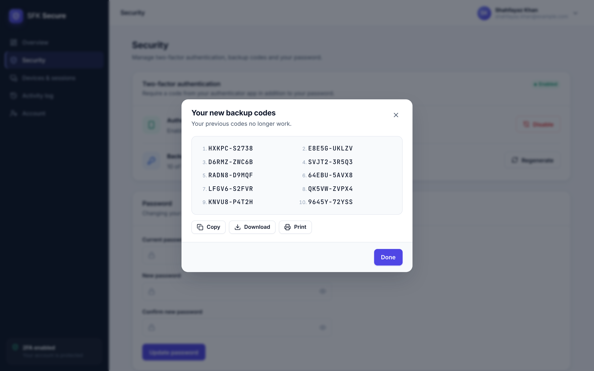 | 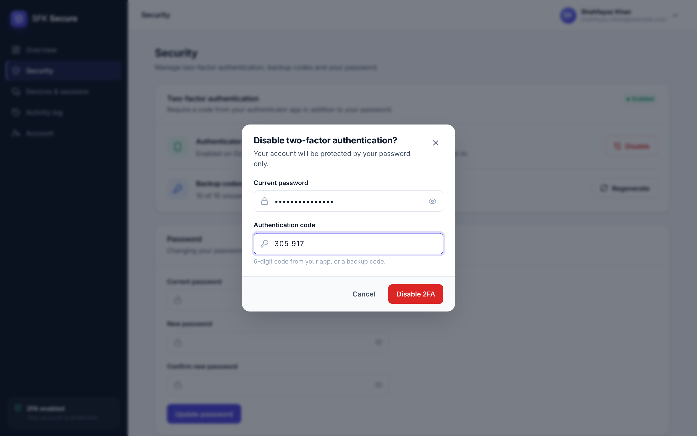 |

Sensitive actions require re-authentication. **Regenerating backup codes** needs a fresh TOTP code and invalidates the old set immediately. **Disabling 2FA** needs both the current password *and* a 6-digit code or a backup code.

### 6. Devices & sessions

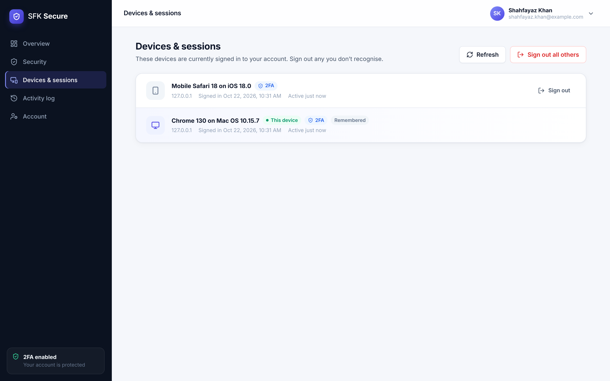

Every active session is listed with:

- **Device details** — browser, OS, device type, IP address, sign-in time and last activity.
- **Badges** — *This device*, *2FA* (the session passed a second factor) and *Remembered* (the user chose *Keep me signed in*).

**Sign out** ends a single remote session immediately. The device is signed out on its next request. **Sign out all others** keeps only the current session. Raw session IDs are never sent to the browser; each session is identified by a hash of its ID.

### 7. Activity log

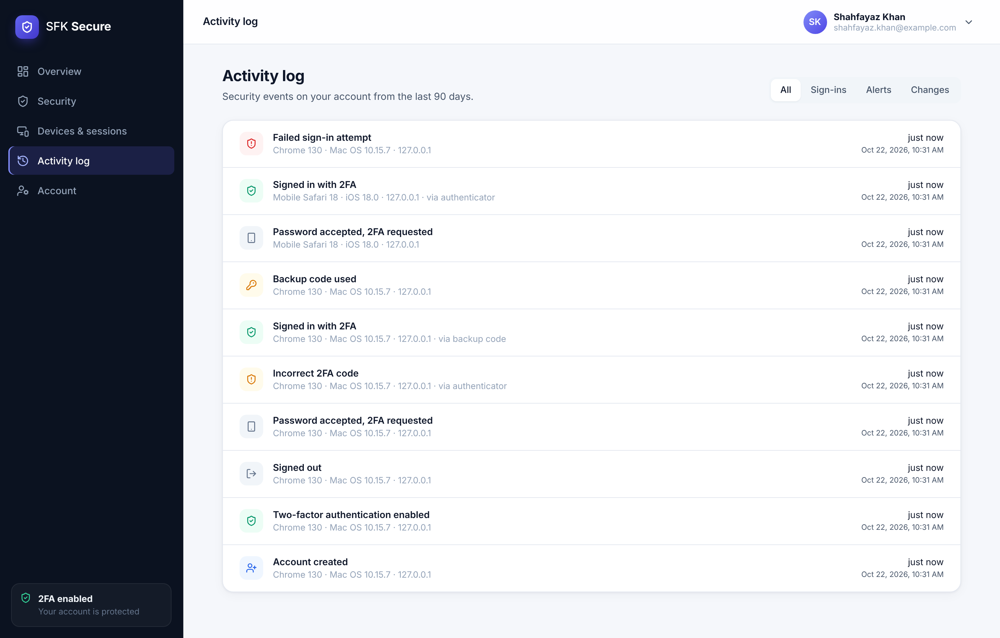

A 90-day audit trail stored in MongoDB, with a TTL index so old events expire automatically. It covers:

- sign-ins and sign-outs
- failed passwords
- 2FA challenges, successes and failures
- backup-code use
- lockouts
- 2FA enabled or disabled
- revoked sessions
- password and profile changes

Each event records browser, OS and IP. The **All · Sign-ins · Alerts · Changes** filters narrow the list, and older events load with cursor-based pagination.

### 8. Account

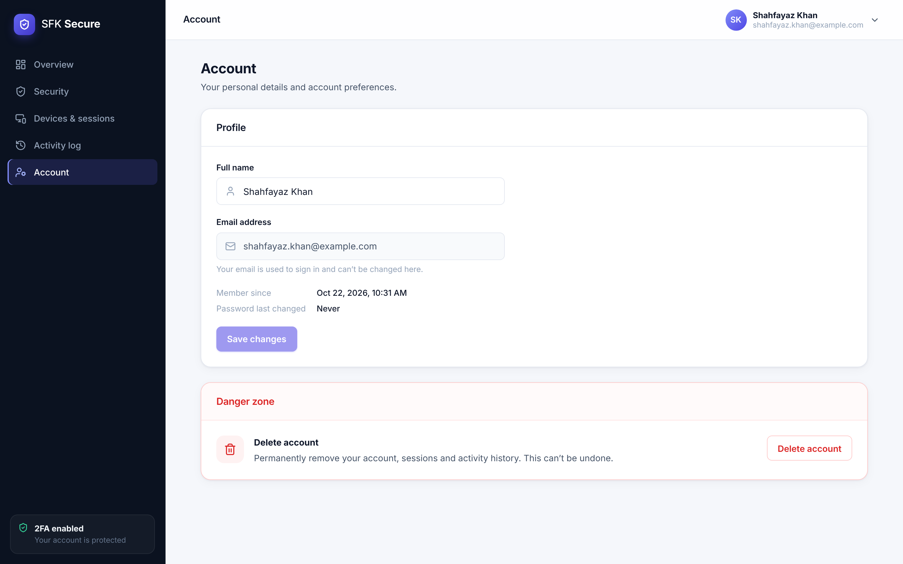

Users can edit their display name, see when they joined and when the password was last changed, and permanently **delete the account**. Deletion requires the password, plus a 2FA code when 2FA is on. It removes the user, all their sessions and their activity history.

### 9. Built-in protections

| Account lockout | Inactivity timeout |
| :---: | :---: |
| 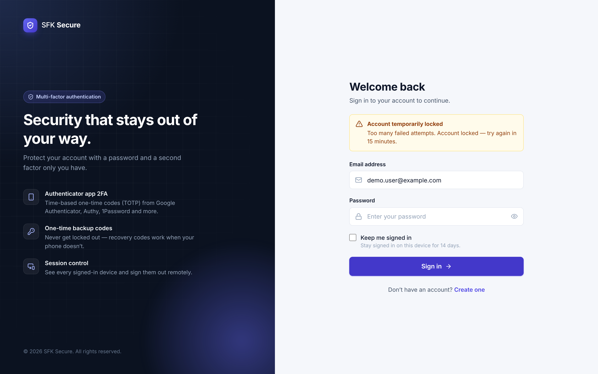 | 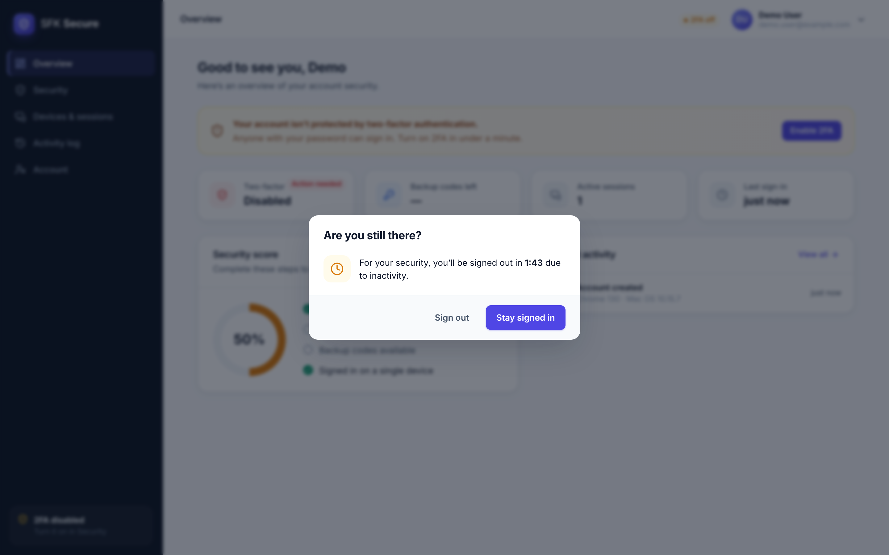 |

- **Account lockout** — after 5 wrong passwords the account is locked for 15 minutes, and even the correct password is refused until then. Separately, per-IP rate limits apply to sign-in and code entry; only failed attempts count toward them.
- **Inactivity timeout** — the client mirrors the server's 60-minute sliding idle timeout. Two minutes before expiry it shows a countdown with **Stay signed in**, which extends the session, and **Sign out**. If the user does nothing, they're signed out automatically.

### 10. Mobile

| Sign in | 2FA code | Dashboard | Navigation |
| :---: | :---: | :---: | :---: |
| 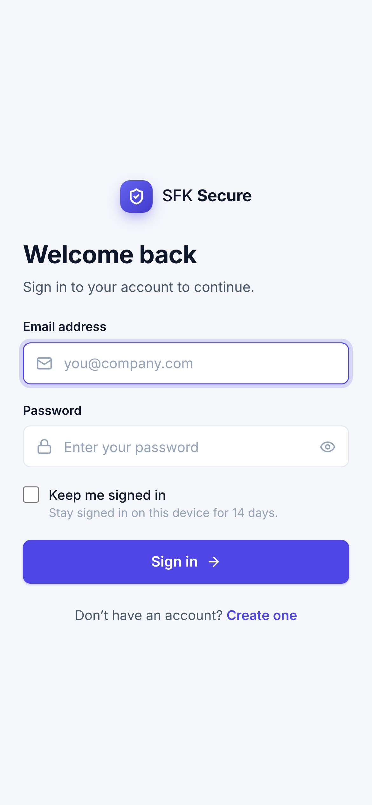 | 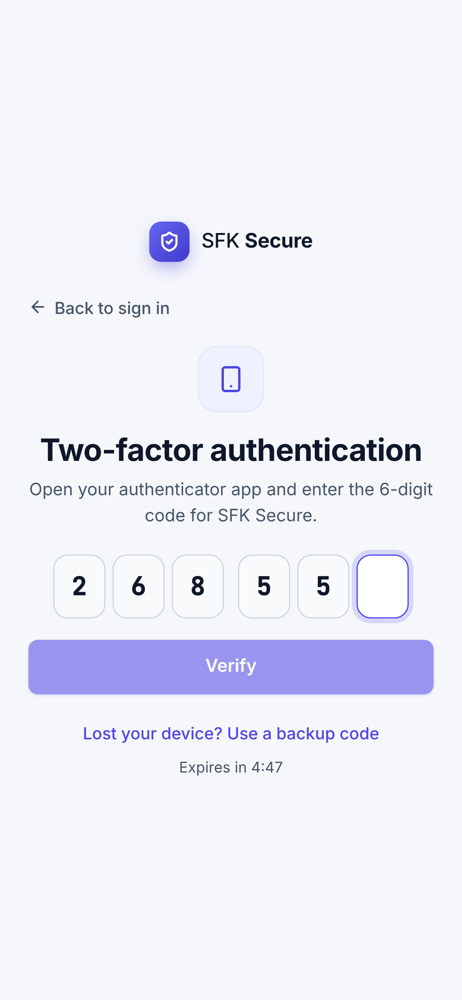 | 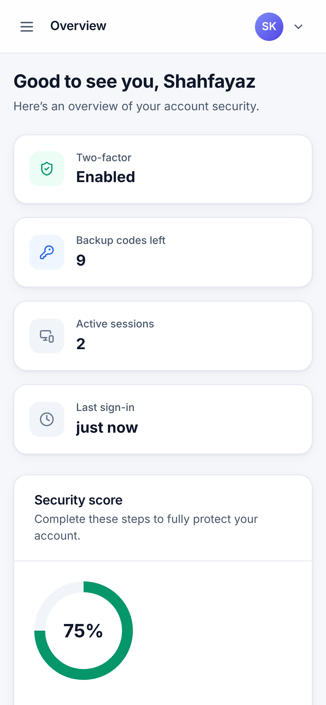 | 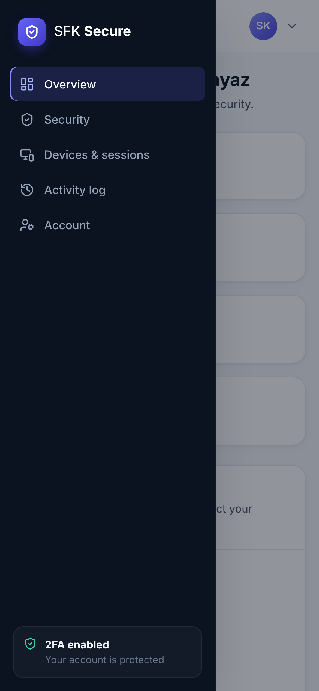 |

The whole UI is responsive. On phones the branded panel is hidden, the sidebar becomes a slide-out drawer, and the code boxes resize to fit. `autocomplete="one-time-code"` lets iOS and Android offer the code automatically.

---

## Architecture & diagrams

The diagrams below are written in [Mermaid](https://mermaid.js.org/) and render directly on GitHub. Exported **SVG** and **PNG** versions are in [`docs/diagrams/`](docs/diagrams/), and the Mermaid sources are in [`docs/diagrams/src/`](docs/diagrams/src/).

### System architecture

The React SPA talks to Express through the Vite dev proxy, so the session cookie is first-party. Every request passes through the middleware chain before reaching a route. Passport handles password checks; the services handle TOTP, backup codes, sessions and auditing. MongoDB stores users, sessions (via `connect-mongo`) and the security log.

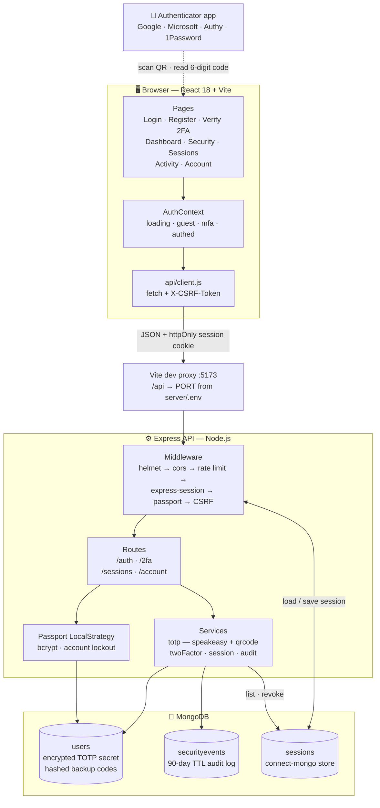

### Sign-in flow (password → 2FA)

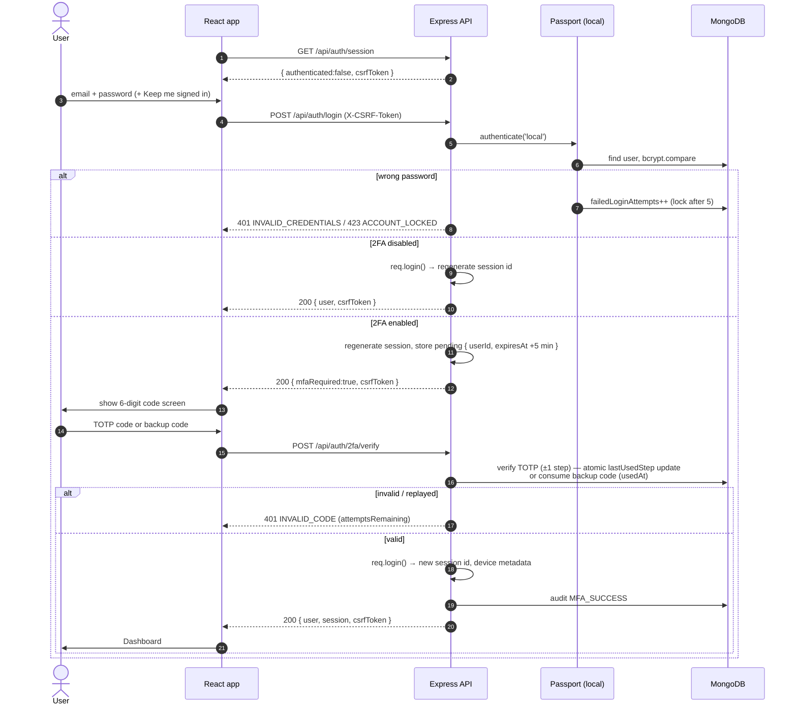

### 2FA enrollment flow (QR code)

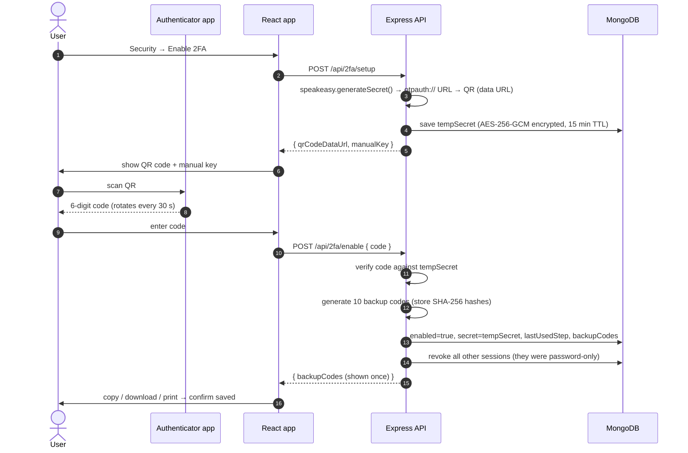

### Client auth states

`AuthContext` tracks one of four states, and the route guards (`GuestRoute`, `MfaRoute`, `ProtectedRoute`) redirect based on it.

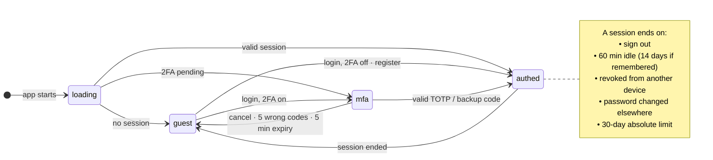

### Data model

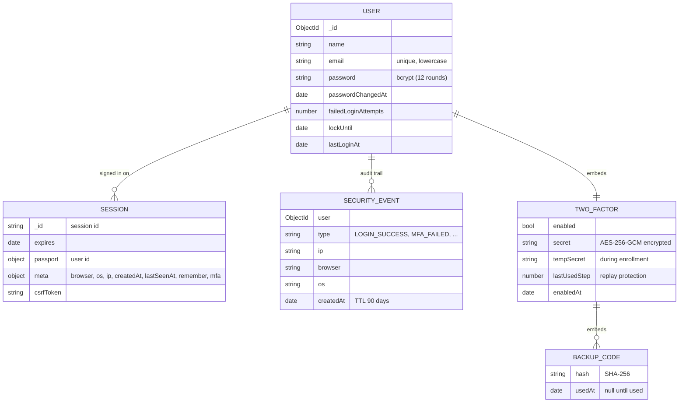

---

## Project structure

```
multi-factor-authentication/
├── client/                     React 18 + Vite
│   ├── src/
│   │   ├── api/client.js       fetch wrapper: cookies, CSRF header, error handling
│   │   ├── context/            AuthContext (auth state machine), ToastContext
│   │   ├── components/         OtpInput, EnrollTwoFactor, BackupCodes, SessionTimeout,
│   │   │                       PasswordStrength, RouteGuards, ui primitives
│   │   ├── layouts/            AuthLayout (split screen), AppLayout (sidebar + topbar)
│   │   ├── pages/              Login, Register, VerifyTwoFactor, Dashboard, Security,
│   │   │                       Sessions, Activity, Account, NotFound
│   │   └── styles/global.css   design system (tokens, components, responsive)
│   └── vite.config.js          /api proxy — reads PORT from server/.env
├── server/                     Express + Passport + Mongoose
│   ├── src/
│   │   ├── config/             env, db, passport (LocalStrategy), session (connect-mongo)
│   │   ├── middleware/         auth guards, CSRF, rate limiters, validation, errors
│   │   ├── models/             User (embedded 2FA + backup codes), SecurityEvent
│   │   ├── services/           totp, twoFactor, session, audit
│   │   ├── controllers/        auth, twoFactor, session, account
│   │   ├── routes/             /api/auth, /api/2fa, /api/sessions, /api/account
│   │   └── validators/         zod schemas
│   └── scripts/                e2e.js (28-check API test), generate-keys.js
├── docs/diagrams/              architecture & flow diagrams (SVG, PNG, Mermaid sources)
├── screenshots/                UI screenshots used in this README
└── docker-compose.yml          local MongoDB
```

---

## Quick start

Requirements: **Node 18+** and **MongoDB** (local install, Atlas, or Docker).

```bash
# 1. Install everything
npm run install:all

# 2. Configure the API
cp server/.env.example server/.env
npm --prefix server run gen:keys      # paste SESSION_SECRET + TOTP_ENCRYPTION_KEY into server/.env

# 3. Start MongoDB (if you don't already have one running)
npm run mongo:up                      # or: brew services start mongodb-community

# 4. Run API + web together
npm run dev
```

Open **http://localhost:5173**, create an account, and you'll go straight to the 2FA setup wizard. Scan the QR code with any authenticator app.

The API runs on the `PORT` in `server/.env` (default **5050**). The React dev proxy reads that value automatically and prints its target when Vite starts.

---

## Configuration

`server/.env`:

| Variable | Default | Description |
| --- | --- | --- |
| `PORT` | `5050` | API port. Avoid `5000` on macOS (AirPlay Receiver). |
| `CLIENT_ORIGIN` | `http://localhost:5173` | Allowed browser origin(s), comma-separated (CORS + CSRF origin check) |
| `MONGO_URI` | `mongodb://127.0.0.1:27017/mfa_auth` | MongoDB connection string |
| `SESSION_SECRET` | — | Cookie signing secret (`npm run gen:keys`) |
| `SESSION_IDLE_MINUTES` | `60` | Sliding idle timeout |
| `SESSION_REMEMBER_DAYS` | `14` | Lifetime when *Keep me signed in* is ticked |
| `TOTP_ENCRYPTION_KEY` | — | 64 hex chars — AES-256-GCM key for TOTP secrets (`npm run gen:keys`) |
| `TOTP_ISSUER` | `SFK Secure` | Name shown in authenticator apps |
| `MFA_PENDING_MINUTES` | `5` | Time allowed to enter the code after a correct password |
| `MAX_LOGIN_ATTEMPTS` / `LOCKOUT_MINUTES` | `5` / `15` | Account lockout policy |

---

## Features

**Authentication**
- Register and sign in with email + password via **Passport `LocalStrategy`**, using bcrypt with 12 rounds.
- Two-step login: password → short-lived *pending-MFA* state (5 min) → TOTP or backup code → full session.
- Generic error messages, plus a constant-time comparison against a dummy hash when the email doesn't exist, so attackers can't tell which emails are registered.
- **Account lockout** after 5 wrong passwords (15 min).
- Per-IP **rate limiting** on login and OTP endpoints; only failed attempts count.

**Two-factor (TOTP)**
- Enrollment wizard with **QR code** and a manual key.
- Secrets generated with **speakeasy**, encrypted at rest with **AES-256-GCM**.
- ±1 time-step window for clock drift, plus **replay protection** using an atomic `lastUsedStep` update.
- 10 **one-time backup codes**, stored as SHA-256 hashes and consumed atomically. They can be regenerated with a fresh code.
- Disabling 2FA requires the password **and** a current code.

**Sessions**
- `express-session` + `connect-mongo`; the cookie is `httpOnly`, `sameSite=lax`, and `secure` in production.
- The session ID is regenerated at login and when 2FA completes, which prevents session fixation.
- Timeouts: 60-minute sliding idle timeout, 14 days with *Keep me signed in*, and a hard 30-day cap.
- A device list lets users sign out one device or all others.
- Changing the password signs out other devices.
- An inactivity warning appears in the UI before sign-out.

**Hardening**
- CSRF synchronizer token (`X-CSRF-Token`) plus an Origin check on every request that changes data.
- `helmet`, strict CORS, a 10 kB JSON body limit and `Cache-Control: no-store`.
- zod validation and a central error handler with machine-readable error codes.
- 90-day security activity log.

---

## API reference

| Method | Route | Auth | Description |
| --- | --- | --- | --- |
| GET | `/api/auth/session` | – | Bootstrap: auth state, user, pending-MFA, CSRF token |
| GET | `/api/auth/csrf` | – | Get a CSRF token |
| POST | `/api/auth/register` | guest | `{ name, email, password }` |
| POST | `/api/auth/login` | – | `{ email, password, remember }` → `{ mfaRequired }` |
| POST | `/api/auth/2fa/verify` | pending | `{ code }` — 6-digit TOTP or backup code |
| POST | `/api/auth/2fa/cancel` | pending | Abandon the 2FA step |
| GET | `/api/auth/me` | ✔ | Current user + session info |
| POST | `/api/auth/logout` | ✔ | Destroy session |
| GET | `/api/2fa/status` | ✔ | Enabled? backup codes remaining |
| POST | `/api/2fa/setup` | ✔ | New secret → QR code data URL + manual key |
| POST | `/api/2fa/enable` | ✔ | `{ code }` → backup codes |
| POST | `/api/2fa/disable` | ✔ | `{ password, code }` |
| POST | `/api/2fa/backup-codes` | ✔ | `{ code }` → new backup codes |
| GET | `/api/sessions` | ✔ | Active sessions |
| DELETE | `/api/sessions/:id` | ✔ | Sign out one device |
| DELETE | `/api/sessions` | ✔ | Sign out all other devices |
| GET | `/api/account/activity` | ✔ | Security log (`?limit&before`) |
| PATCH | `/api/account/profile` | ✔ | `{ name }` |
| POST | `/api/account/password` | ✔ | `{ currentPassword, newPassword }` |
| DELETE | `/api/account` | ✔ | `{ password, code? }` |

Every request that changes data needs the `X-CSRF-Token` header; the client adds it automatically. Errors share one shape: `{ "error": { "message", "code", "details?" } }`.

---

## Testing

With the API running:

```bash
npm run test:e2e
```

This runs **28 end-to-end checks** against the real API:

- CSRF enforcement
- registration validation
- QR setup and enabling 2FA
- logout
- the pending-MFA lock
- TOTP replay rejection
- valid TOTP sign-in
- single-use backup codes
- listing and revoking sessions
- the activity log
- password change
- disabling 2FA
- account lockout
- account deletion

---

## Troubleshooting

| Symptom | Fix |
| --- | --- |
| Sign-up/sign-in says *"Can't reach the API at …"* | Start the API (`npm run dev:server`) and check MongoDB is running. The proxy target is printed when Vite starts. |
| API exits with *"Port … is already in use"* | Change `PORT` in `server/.env` (on macOS, 5000 is taken by AirPlay Receiver). Restart **both** API and web so the proxy picks it up. |
| *"Request origin … is not allowed"* | Add the URL you open the app on to `CLIENT_ORIGIN` (comma-separated). |
| API exits with *"Could not connect to MongoDB"* | `brew services start mongodb-community` or `npm run mongo:up`, and check `MONGO_URI`. |
| Authenticator codes are always rejected | Make sure the phone's clock is set automatically. TOTP allows only ±30 s of drift. |

---

## Production notes

- Set `NODE_ENV=production` and a real `CLIENT_ORIGIN`, and serve over HTTPS so cookies are `secure`. `trust proxy` is enabled in production for nginx and load balancers.
- Serve `client/dist` from the same domain as the API, or use a reverse proxy that routes `/api` to Express, so the session cookie stays first-party.
- Keep `TOTP_ENCRYPTION_KEY` stable: changing it makes existing 2FA secrets unreadable.
- `express-rate-limit` keeps its counters in memory; use a Redis store when running more than one API instance.
